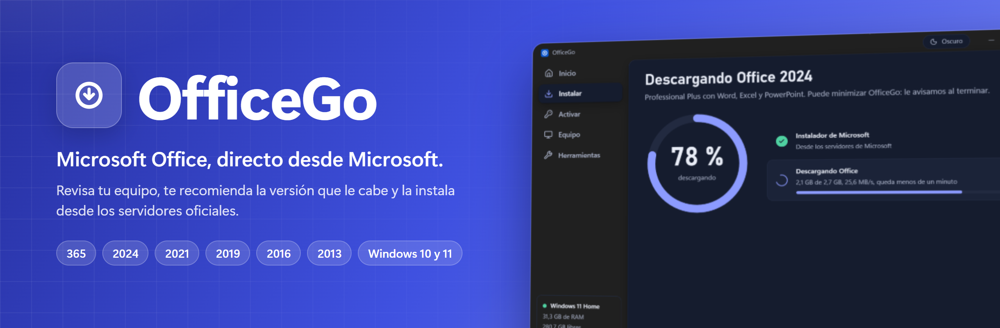
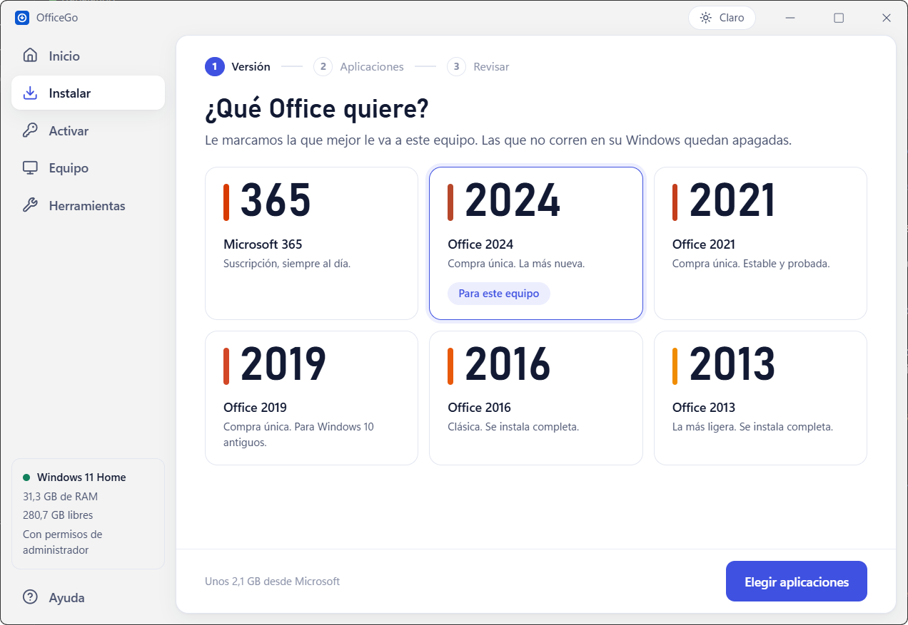
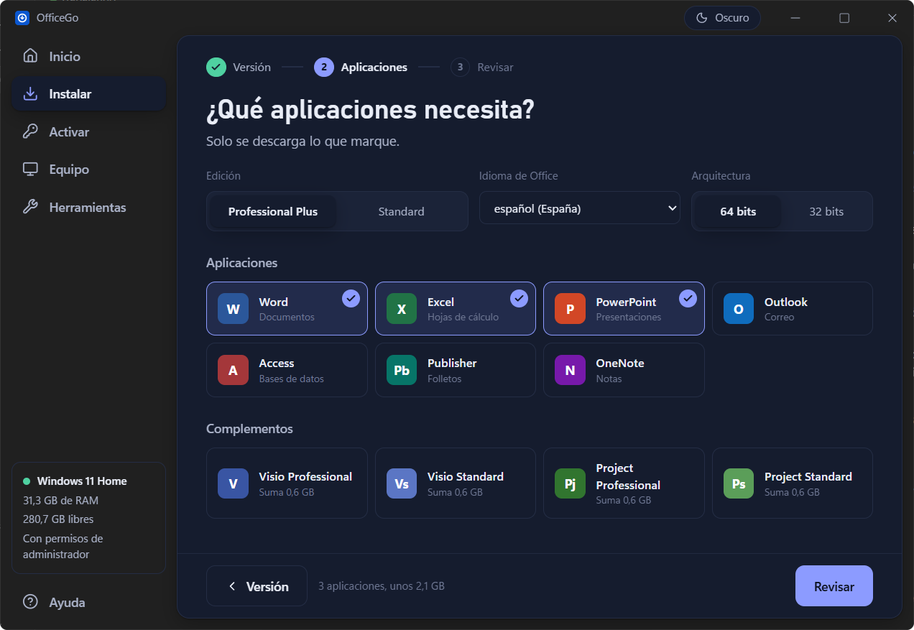
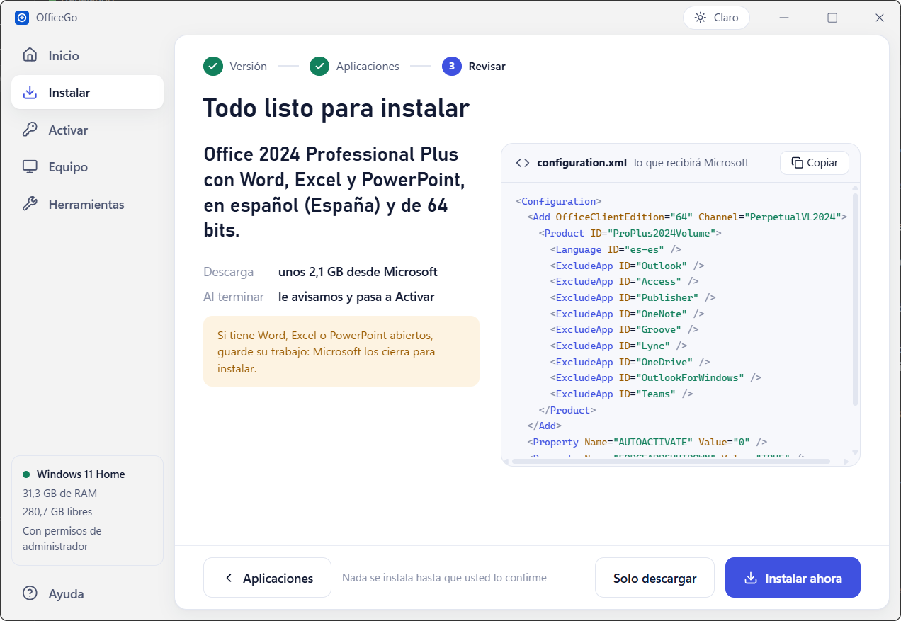
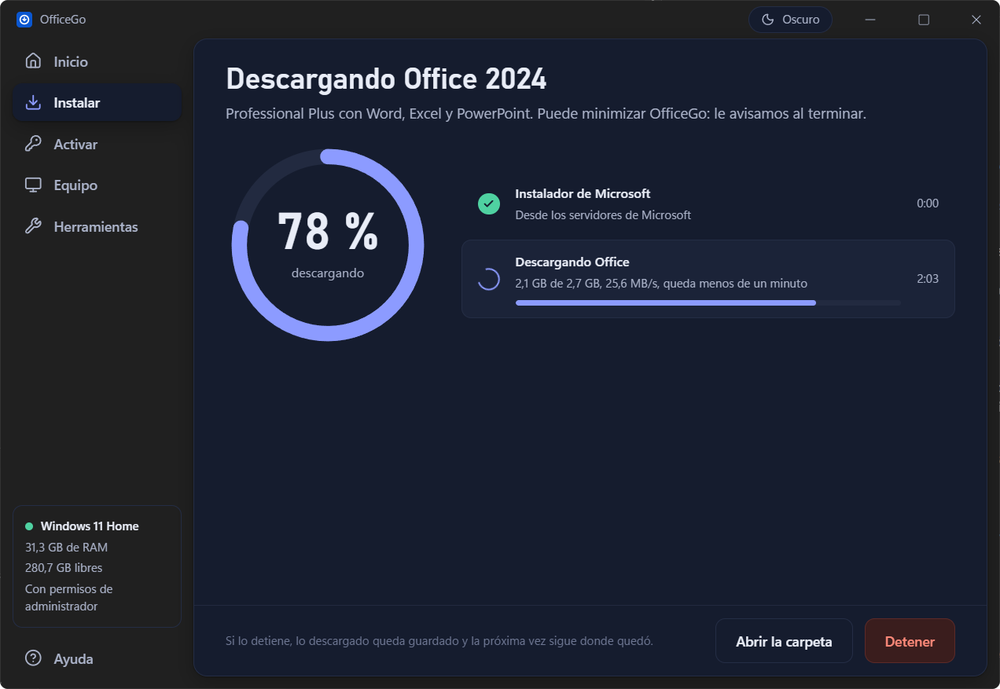
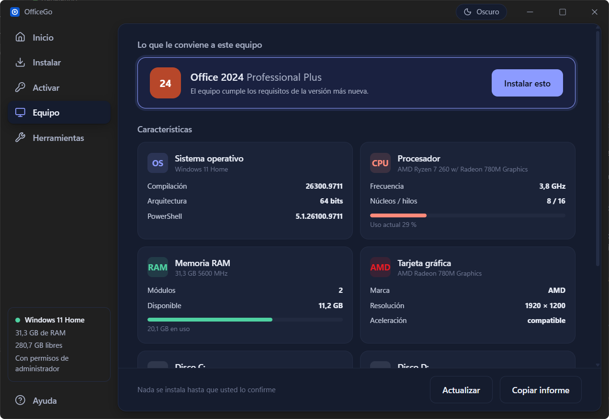

<p align="center"></p>

<p align="center">
  <a href="https://github.com/MariaDSalazar/officego/releases/latest"></a>
  <a href="https://github.com/MariaDSalazar/officego/releases"></a>
  
  
  <a href="LICENSE"></a>
</p>

<p align="center"><b>Instalador de Microsoft Office para Windows 10 y 11.</b> Mira tu equipo, te dice qué versión le
cabe y la baja de los servidores de Microsoft con lo que marques: Word y Excel solos, la suite entera o con Visio y
Project. Después la activa con tu clave, la repara si algo falla y te prepara un instalador sin conexión para el resto
de equipos de la casa o del aula. Viene como app de escritorio, en español e inglés y que se actualiza sola, y como un
script de PowerShell que funciona hasta en el portátil más viejo.</p>

<p align="center">
  <a href="https://github.com/MariaDSalazar/officego/releases/latest/download/OfficeGo-setup.exe"><b>Descargar la app</b></a> ·
  <a href="https://github.com/MariaDSalazar/officego/releases/latest/download/OfficeGo.exe"><b>Versión PowerShell</b></a> ·
  <a href="#con-un-comando"><b>Con un comando</b></a> ·
  <a href="docs/TUTORIAL.md"><b>Tutorial paso a paso</b></a>
</p>

<p align="center"></p>

*English version below.*

## Novedades

**2.5.0**

- **La app de escritorio vuelve a abrir en equipos sin Office.** La 2.4.0 se quedaba en el error de carga justo donde
  más falta hace, y daba por fallida toda tarea que salía bien.
- **Avance de verdad:** Office se descarga primero, con el porcentaje real, la velocidad y lo que falta, y después se
  instala desde esa carpeta. La descarga se puede detener y sigue donde quedó.
- **Instalar en tres pasos:** versión, aplicaciones y revisar. Las versiones que no corren en tu Windows salen apagadas
  con lo que piden, y antes de instalar ves el `configuration.xml` que recibirá Microsoft.
- **Tema claro y oscuro**, o el de tu Windows, con el fondo Mica de Windows 11. El botón de la barra de tareas muestra el
  avance y Windows te avisa al terminar.

**2.4.0:** app de escritorio nueva en Svelte 5 y Rust, clave de producto, reparar e instalador sin conexión en la app,
Office 2016 y 2013 de 32 bits y Office 2019 a 365 bien detectados. **2.3:** Reparar funciona por fin, se detecta Office
2013 y el inicio avisa si faltan permisos. **2.2:** arregla el comando de una línea y los botones que dejaban la 2.1 sin
responder. **2.1:** opciones en la línea de órdenes y modo desatendido para aulas. **2.0:** la primera app de
escritorio. Todas las notas en [Releases](../../releases). Desde la 2.4.0 las versiones siguen el [versionado
semántico](https://semver.org/lang/es/): el tercer número sube con arreglos y el segundo con funciones nuevas.

## Así se ve

<table>
  <tr>
    <td width="50%"><br><b>Aplicaciones:</b> edición, idioma y arquitectura, y solo las apps que marques. En tema claro u oscuro</td>
    <td width="50%"><br><b>Sin secretos:</b> antes de instalar ves tu elección y el <code>configuration.xml</code> exacto que recibirá Microsoft</td>
  </tr>
  <tr>
    <td><br><b>Avance de verdad:</b> porcentaje, velocidad y lo que falta; si la detienes, sigue donde quedó</td>
    <td><br><b>Equipo:</b> procesador, memoria, discos y gráfica, con la recomendación arriba</td>
  </tr>
  <tr>
    <td colspan="2" align="center"><br><b>Versión PowerShell:</b> la misma recomendación en Windows Forms, sin instalar nada</td>
  </tr>
</table>

## Qué hace

- **Te recomienda la versión:** lee Windows, memoria, disco y gráfica, y aplica los requisitos que publica Microsoft.
  Con menos de 4 GB de RAM baja sola a Office 2016, y te avisa si falta espacio, si el Windows es de 32 bits o si la
  gráfica es antigua.
- **Seis versiones de Office:** Microsoft 365, 2024, 2021, 2019, 2016 y 2013, cada una con sus ediciones (Professional
  Plus, Standard, Home & Business…) y en siete idiomas.
- **Tú eliges las aplicaciones:** solo Word y Excel, o todas. Al cambiar de edición se ajustan solas: con Standard se
  apaga Access porque esa edición no lo trae. Visio y Project entran como complementos en el mismo pedido.
- **Activación:** con tu clave de 25 caracteres, con guiones o sin ellos, o con MAS sin abrir su menú. Todo pasa dentro
  de la ventana y al terminar te dice si Office quedó activado.
- **Reparar:** la reparación rápida de Microsoft, sin descargar nada y sin tocar tus documentos ni la licencia.
- **Instalador sin conexión:** baja Office a una carpeta con `setup.exe`, su `configuration.xml` e `instalar.cmd`.
  Copias la carpeta a otro equipo, la abres y se instala sin internet.
- **Desinstalar con cuidado:** quita Office pero no tus documentos, y antes te pide escribir una palabra, para que un
  clic sin querer no baste.
- **Conoce tu equipo:** uso del procesador, memoria, cada disco con su espacio libre y la gráfica con su marca, más un
  informe para copiar y pegar cuando pidas ayuda.
- **Para aulas:** la versión PowerShell instala sin ventanas y con las mismas opciones en todos los equipos
  (`-Instalar 2021 -Apps Word,Excel -Silencioso -Activar`).
- **Siempre al día:** la app te avisa de cada versión nueva, comprueba que la descarga llegó entera y se instala encima
  sin perder nada.

## Cómo funciona

Mira el equipo con WMI => elige la versión con los requisitos de Microsoft => arma el `configuration.xml` con lo que
marcaste => baja el instalador oficial de `officecdn.microsoft.com` (o de `c2rsetup.officeapps.live.com` para 2016 y
2013) => Microsoft instala Office => lo activas con tu clave o con MAS. La app de escritorio y la versión PowerShell usan
**el mismo motor** (`src/*.ps1`): en la app, Rust lo lanza y Svelte pinta lo que responde, paso a paso. En la app,
2019, 2021, 2024 y 365 van en dos tiempos: `setup.exe /download` deja Office en `%TEMP%\OfficeGo` midiendo en el disco
cuánto lleva, y `setup.exe /configure` lo instala desde ahí.

| Vía de Microsoft | Para | ¿Se eligen aplicaciones? |
|---|---|---|
| **Office Deployment Tool** · `setup.exe /download` y `/configure` | Microsoft 365, 2024, 2021 y 2019 | Sí |
| **Click-to-Run** · `c2rsetup.officeapps.live.com` | 2016 y 2013 | No, baja la suite entera |

## Seguridad y privacidad

- **Solo Microsoft:** Office se descarga únicamente de los servidores de Microsoft y lo instala su propia herramienta.
  MAS solo se baja si pulsas su botón.
- **Nada sin tu permiso:** no se instala, activa, repara ni desinstala nada hasta que lo confirmas.
- **Sin telemetría:** no hay cuentas ni estadísticas de uso. Lo único que sale de tu equipo, aparte de las descargas de
  Microsoft, es la consulta de la app a GitHub para saber si hay versión nueva.
- **Todo a la vista:** trabaja en `%TEMP%\OfficeGo`, donde quedan el instalador de Microsoft, sus registros y Office
  mientras se instala (Herramientas → Abrir la carpeta de trabajo). El código es abierto y se compila en GitHub a la
  vista de todos.

## Cómo se usa

### Con la app

1. **Descarga** [`OfficeGo-setup.exe`](https://github.com/MariaDSalazar/officego/releases/latest/download/OfficeGo-setup.exe)
   e instálalo. Si Windows avisa con «Windows protegió su PC», pulsa **Más información** → **Ejecutar de todas formas**.
2. **Ábrelo** desde el menú Inicio. Si te pide permisos de administrador, pulsa **Reiniciar con permisos**.
3. **Elige:** acepta la versión que te recomienda con **Instalar esto**, o ve por los tres pasos de **Instalar**:
   versión, aplicaciones y revisar.
4. **Instala** con **Instalar ahora**. Verás cuánto lleva la descarga y cuánto falta; si la detienes, sigue donde quedó.
   Word, Excel y PowerPoint se cierran si estaban abiertos.
5. **Activa** en **Activar** con tu clave de producto.

¿Sin instalar nada? [`OfficeGo-portable.exe`](https://github.com/MariaDSalazar/officego/releases/latest/download/OfficeGo-portable.exe)
es la misma app en un solo archivo, para llevar en un USB.

### Con un comando

Abre **PowerShell como administrador** (tecla <kbd>Windows</kbd>, escribe `PowerShell`, *Ejecutar como administrador*)
y pega:

```powershell
irm https://raw.githubusercontent.com/MariaDSalazar/officego/main/OfficeGo.ps1 | iex
```

Se abre la versión PowerShell. Si no lo abriste como administrador, lo nota, pide los permisos y se vuelve a abrir.
También está en un archivo: [`OfficeGo.exe`](https://github.com/MariaDSalazar/officego/releases/latest/download/OfficeGo.exe),
doble clic y listo.

<details><summary><b>Todas las opciones para instalar sin ventanas</b></summary>

```powershell
& ([scriptblock]::Create((irm https://raw.githubusercontent.com/MariaDSalazar/officego/main/OfficeGo.ps1))) -Instalar 2021 -Apps Word,Excel,PowerPoint -Silencioso -Activar
```

| Opción | Qué hace |
|---|---|
| `-Instalar` | `365` `2024` `2021` `2019` `2016` `2013` |
| `-Edicion` | `ProPlus` (por defecto), `Standard`, `Professional`, `HomeStudent`… |
| `-Apps` | `Word,Excel,PowerPoint`. Lo que no se nombre no se instala |
| `-Complementos` | `VisioPro`, `VisioStd`, `ProjectPro`, `ProjectStd` |
| `-Idioma` | `es-es` (por defecto), `es-mx`, `en-us`, `pt-br`, `fr-fr`, `de-de`, `it-it` |
| `-Bits` | `64` o `32`. Por defecto, los del Windows |
| `-Activar` | Activa al terminar. Sin `-Instalar`, solo activa |
| `-Desinstalar` | Quita Office del equipo |
| `-Silencioso` | Sin ventanas de Microsoft ni preguntas |
| `-Ayuda` | Muestra todo esto en la consola |

Con `irm | iex` no se pueden pasar opciones; por eso se usa `[scriptblock]::Create`. `OfficeGo.exe` acepta las mismas:
`.\OfficeGo.exe -Instalar 2021 -Apps Word,Excel`.

</details>

### Qué versión te toca

| Versión | Necesita |
|---|---|
| Office LTSC **2024** | Windows 11, o Windows 10 versión 22H2 |
| Office LTSC **2021** | Windows 10 versión 1809 o superior |
| Office **2019** | Windows 10 |
| Office **2016** y **2013** | Windows 7 SP1 o superior |

Requisitos de OfficeGo: Windows 10 u 11, permisos de administrador, 5 GB libres en la unidad del sistema e internet (o
un instalador sin conexión hecho antes). La app de escritorio usa WebView2, que viene con Windows 11 y Windows 10 al
día; si falta, el instalador lo pone.

## Preguntas frecuentes

<details><summary><b>¿Qué versión de OfficeGo bajo?</b></summary>
La app (<code>OfficeGo-setup.exe</code>) si tu Windows está al día: tiene la interfaz más cómoda, habla español o inglés
y se actualiza sola. La versión PowerShell (<code>OfficeGo.exe</code> o el comando) si el equipo es viejo, si no puedes
instalar programas o si vas a preparar varios equipos sin ventanas. Las dos instalan exactamente lo mismo.
</details>
<details><summary><b>Windows dice «Windows protegió su PC»</b></summary>
Sale con cualquier programa descargado que no esté firmado, y firmarlo cuesta cientos de dólares al año. Pulsa
<b>Más información</b> → <b>Ejecutar de todas formas</b>. Si prefieres no bajar ningún <code>.exe</code>, usa el
comando, o compila el tuyo con <code>compilar-exe.bat</code>, que usa el compilador de C# que ya trae Windows.
</details>
<details><summary><b>El antivirus bloquea la activación</b></summary>
El instalador no da problemas: descarga de Microsoft y no hace nada oculto. MAS sí lo detecta Windows Defender,
siempre y por diseño, como avisa su propia web. Si lo usas, pausa la protección en tiempo real, activa y vuelve a
encenderla. OfficeGo te lo recuerda antes de lanzarlo.
</details>
<details><summary><b>Quiero instalar Office en un equipo sin internet</b></summary>
En un equipo con conexión, <b>Herramientas → Crear instalador sin conexión</b> baja la versión elegida a una carpeta.
Copia la carpeta entera al otro equipo y abre <code>instalar.cmd</code>. Office 2016 y 2013 no se pueden bajar así:
Microsoft solo los instala en línea.
</details>
<details><summary><b>Ya tengo Office instalado, ¿qué pasa si instalo otro?</b></summary>
Lo más limpio es quitar el que tienes con <b>Desinstalar</b> antes de poner otra versión: mezclar versiones de Office
suele dar problemas. Si solo quieres arreglar el que ya tienes, usa <b>Reparar</b>.
</details>
<details><summary><b>La barra de progreso se queda quieta</b></summary>
Mientras Microsoft descomprime, la barra puede pararse varios minutos. Si el tiempo de abajo sigue corriendo, está
trabajando.
</details>
<details><summary><b>¿Cómo se actualiza?</b></summary>
La app instalada te avisa en la barra lateral y se actualiza con un botón, sin desinstalar nada. La portable te lleva a
la página de descarga. La versión PowerShell baja siempre la última cuando usas el comando.
</details>
<details><summary><b>¿Funciona en Windows 7 u 8?</b></summary>
No. OfficeGo necesita Windows 10 u 11, aunque Office 2016 y 2013 sí admitan sistemas más viejos.
</details>

<details><summary><b>Para desarrolladores</b></summary>

```
officego/
├── src/                El motor y la versión PowerShell (catálogo, motor, recomendación, ventana y arranque)
├── tauri/              La app de escritorio: Svelte 5 en src/, Rust en src-tauri/, textos en locales/
├── OfficeGo.ps1        Se genera con build.sh a partir de src/: no se edita a mano
├── test.ps1 y prueba-*.ps1   Pruebas de la versión PowerShell
└── docs/               Tutorial, guía rápida y pruebas en máquina virtual
```

```bash
./build.sh                             # junta src/*.ps1 y valida la sintaxis
pwsh test.ps1                          # 65 pruebas del motor
pwsh prueba-arranque.ps1               # que arranque por irm|iex y como archivo
pwsh prueba-interfaz.ps1 -Factor 1.15  # que ninguna pantalla se solape, con letra más ancha
```

La app tiene su guía en [`tauri/LEEME.md`](tauri/LEEME.md): lint, tipos, clippy y 38 pruebas de Rust, una de ellas
contra el motor real. Una versión se publica subiendo la etiqueta `vX.Y.Z`; el CI lo comprueba todo en Windows y sube
los archivos con [`CHANGELOG.md`](CHANGELOG.md) como notas.

</details>

## Creadores

| | | |
|---|---|---|
|  | **[Diego Fernando Loján Tenesaca](https://github.com/DiegoFernandoLojanTenesaca)** · @DiegoFernandoLojanTenesaca | autor |
|  | **[María del Carmen Salazar Torres](https://github.com/MariaDSalazar)** · @MariaDSalazar | coautora |

Gracias a Microsoft por la [Office Deployment Tool](https://learn.microsoft.com/microsoft-365-apps/deploy/overview-office-deployment-tool),
a [MAS](https://github.com/massgravel/Microsoft-Activation-Scripts) y a la comunidad de [massgrave.dev](https://massgrave.dev),
de donde salió la idea del catálogo de versiones. ¿Algo no funciona? [Abre un issue](../../issues/new) con una captura.

## Aviso

Proyecto independiente, sin relación con Microsoft ni respaldado por ella. Microsoft, Office y Windows son marcas de
Microsoft Corporation. Activar productos sin licencia va contra los términos de Microsoft: OfficeGo se publica con fines
educativos y para administrar equipos propios. Úsalo bajo tu responsabilidad. Licencia [MIT](LICENSE).

---

## English

**OfficeGo** installs Microsoft Office on Windows 10 and 11 straight from Microsoft's servers. It checks your computer,
recommends the version that fits it, and installs exactly the apps you tick. It comes as a desktop app (Svelte 5 and
Rust, Spanish and English, light and dark, real download progress that can be paused, updates itself) and as a
PowerShell script that runs even on old laptops, with an unattended mode for classrooms. By
**@DiegoFernandoLojanTenesaca** and **@MariaDSalazar**.

- **Recommends a version:** reads Windows, memory, disk and graphics, and applies Microsoft's published requirements.
- **Six Office versions:** Microsoft 365, 2024, 2021, 2019, 2016 and 2013 with their editions, plus Visio and Project.
- **Pick your apps:** only Word and Excel, or the whole suite; editions adjust what can be ticked.
- **Activation, repair and uninstall:** product key (or MAS), Microsoft's quick repair, and a typed confirmation to
  remove Office.
- **Offline installer:** a folder with `setup.exe`, `configuration.xml` and `instalar.cmd` to install on another
  computer without internet.
- **Private:** no telemetry; only Microsoft downloads and the app's update check on GitHub.

Download [`OfficeGo-setup.exe`](https://github.com/MariaDSalazar/officego/releases/latest/download/OfficeGo-setup.exe)
from [Releases](../../releases/latest), or run the PowerShell version with
`irm https://raw.githubusercontent.com/MariaDSalazar/officego/main/OfficeGo.ps1 | iex` in an elevated PowerShell. Not
affiliated with or endorsed by Microsoft. MIT License.
