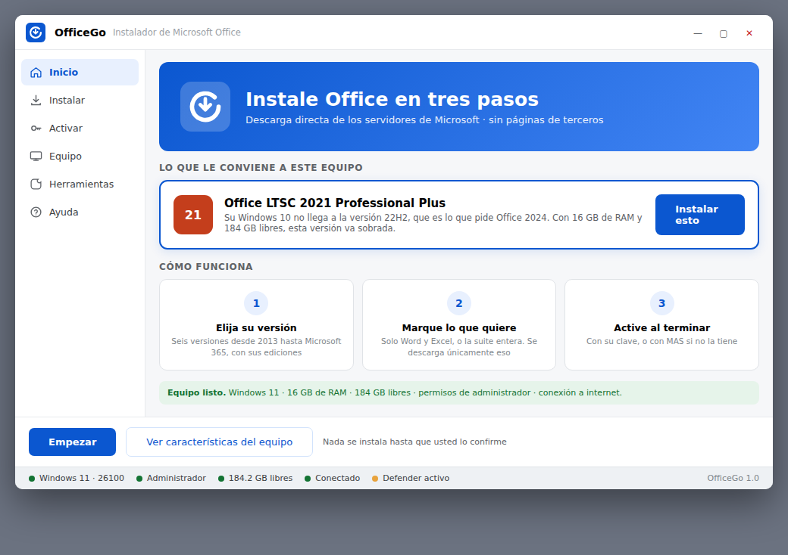
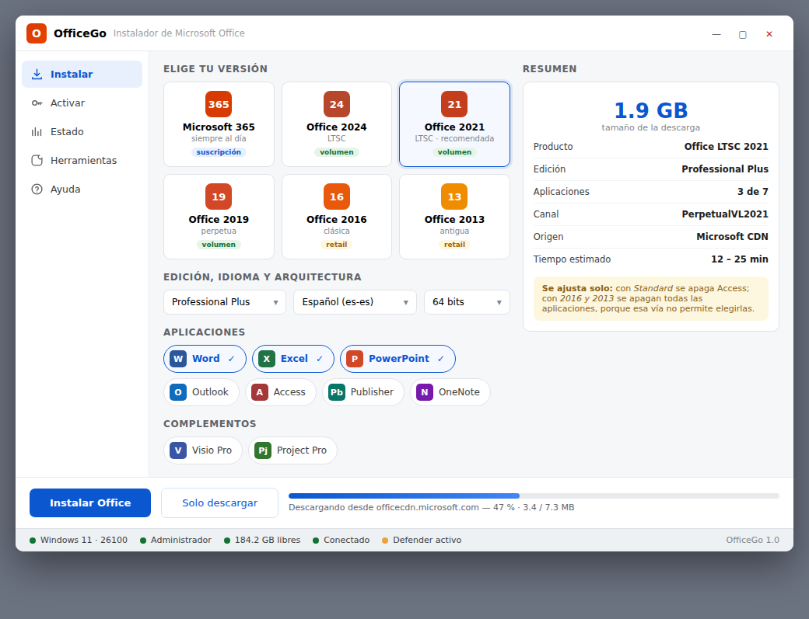
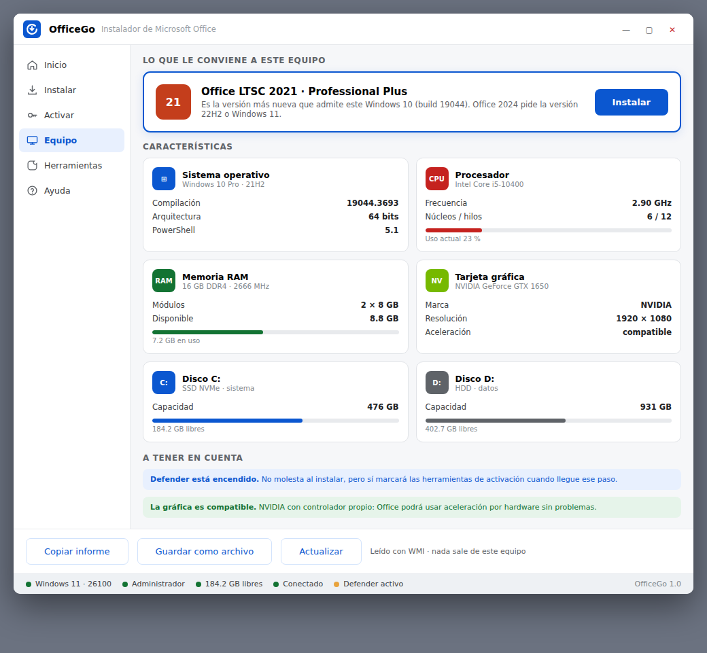
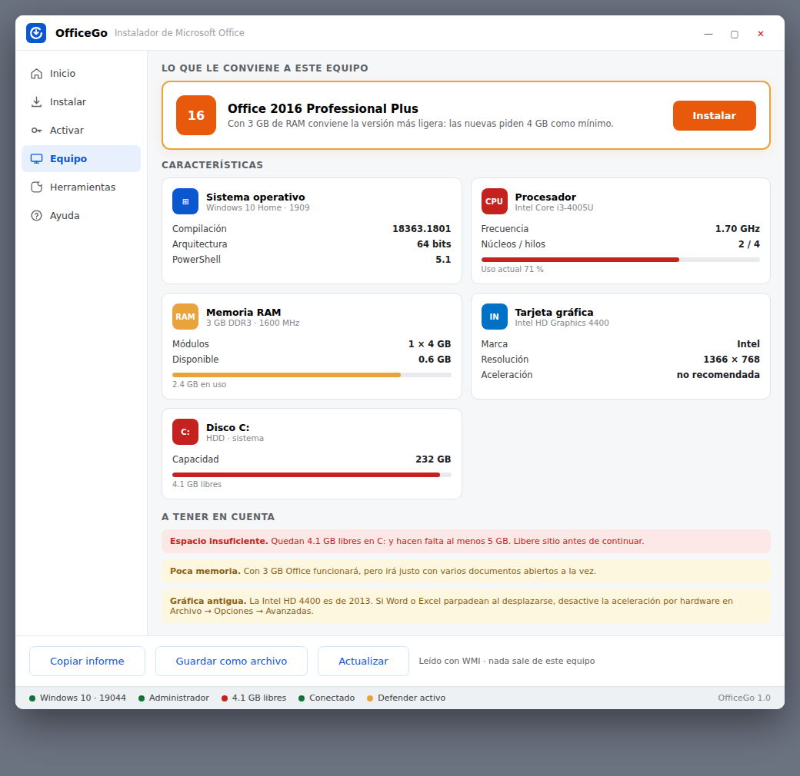
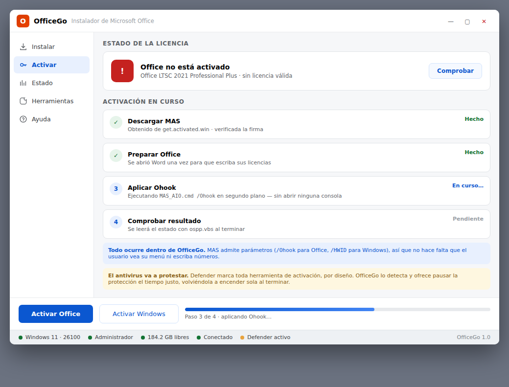
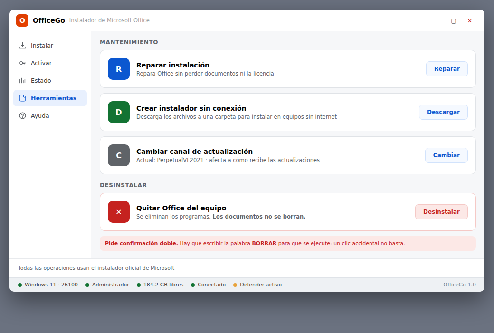
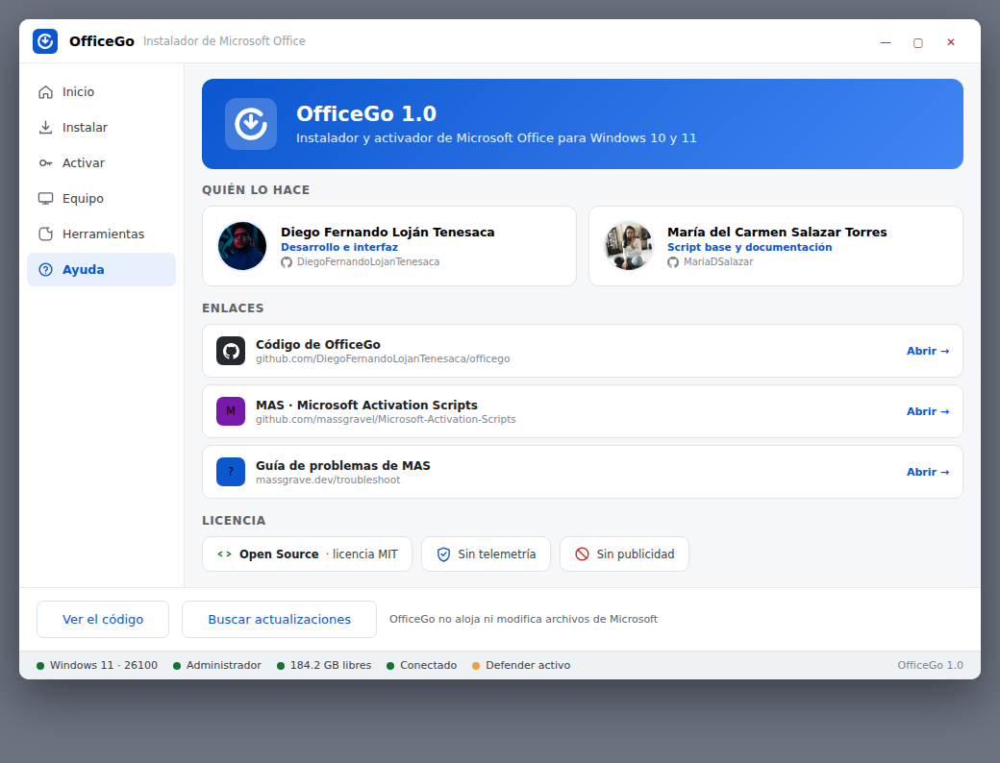

<div align="center">
  
  <h1>OfficeGo</h1>
  <p>
    <strong>Instalador y activador de Microsoft Office — directo desde Microsoft.</strong><br>
    Sin páginas de terceros, sin archivos de dudosa procedencia, sin instalar nada previo.
    Un solo archivo que se abre y funciona.
  </p>
  <p>
    
    
    
    
    
    
    
  </p>
  <p>
    <a href="#-puesta-en-marcha"></a>
  </p>
  <p><em>Lo primero que ves no es un menú: es qué versión le conviene a tu equipo.</em></p>
</div>

---

**OfficeGo** instala Microsoft Office en Windows 10 y 11 desde una ventana sencilla.
Pide los archivos a los **servidores oficiales de Microsoft** (`officecdn.microsoft.com`
y `c2rsetup.officeapps.live.com`) con las opciones que elijas en pantalla, y te deja
activarlo con tu clave o con [MAS](https://github.com/massgravel/Microsoft-Activation-Scripts).

Está escrito en **PowerShell con Windows Forms**: eso significa que es un archivo de
texto legible, que no hay que instalar ningún runtime, y que el antivirus no se pone
nervioso como con un `.exe` descargado.

> **Nada se instala hasta que lo confirmas.** El programa arranca revisando tu equipo
> — Windows, memoria, disco, gráfica — y recomienda la versión que de verdad te cabe.
> Con 3 GB de RAM te propone Office 2016, no la última.



## Features

| | Feature | Qué hace |
|---|---|---|
| 🎯 | **Recomienda por ti** | Lee Windows, RAM, disco y gráfica, y propone la versión adecuada según los requisitos publicados por Microsoft. Con poca memoria baja sola a 2016. |
| 📦 | **Seis versiones** | Microsoft 365, Office **2024**, **2021**, **2019**, **2016** y **2013**, cada una con sus ediciones: Professional Plus, Standard, Home & Business, Personal. |
| ✅ | **Eliges qué instalar** | Solo Word y Excel, o la suite entera. Al cambiar de edición las aplicaciones se ajustan solas: con *Standard* se apaga Access, porque esa edición no lo trae. |
| 📐 | **Visio y Project** | Como complementos, en el mismo `configuration.xml` que Office. |
| 🔑 | **Activación integrada** | Con tu clave de 25 caracteres, o con MAS ejecutado con `/Ohook` **sin abrir su menú**: todo ocurre dentro de la ventana. |
| 🖥️ | **Conoce tu equipo** | Procesador con uso en vivo, memoria, cada disco con su ocupación y la tarjeta gráfica con su marca — NVIDIA, AMD o Intel. |
| 🧰 | **Herramientas** | Reparar la instalación, crear un instalador sin conexión para otros equipos, y desinstalar (pidiendo escribir `BORRAR`). |
| 🚑 | **Ayuda de verdad** | Los errores frecuentes con el **mensaje literal** que sale en pantalla y el comando exacto que los arregla. |
| 🪶 | **Portable** | Un `.ps1` de 68 KB. Cabe en un USB, no deja rastro en el registro, no necesita instalarse. |
| 🔒 | **Sin telemetría** | No manda nada a ninguna parte. El código está aquí para leerlo. |

<details>
<summary><strong>Arquitectura</strong></summary>

<br>

```
 Equipo ─► WMI (Windows, CPU, RAM, discos, GPU) ─► recomendación de versión
        ─► catálogo (Product ID + vía + canal) ─► configuration.xml
        ─► setup.exe /configure  ó  c2rsetup ─► Office instalado
        └─► [opcional] MAS /Ohook en segundo plano ─► activado

              todo en PowerShell + Windows Forms, sin dependencias externas
```

**Dos vías, y no son intercambiables:**

| Vía | Sirve | ¿Elegir aplicaciones? |
|---|---|---|
| **ODT** · `setup.exe /configure` | Microsoft 365, Office 2024 / 2021 / 2019 (volumen) | Sí, con `<ExcludeApp>` |
| **C2R** · `c2rsetup.officeapps.live.com` | Office 2016 y 2013 (retail) | No: descarga la suite entera |

Por eso, al elegir 2016 o 2013, la columna de aplicaciones se desactiva sola. No es
una limitación del programa, es de Microsoft.

```
officego/
├── OfficeGo.ps1        → el programa · se genera con build.sh · NO editar a mano
├── OfficeGo.cmd        → lanzador de doble clic, pide permisos solo
├── compilar-exe.bat    → genera OfficeGo.exe con el csc.exe que Windows ya trae
├── src/
│   ├── 1-catalogo.ps1      Versiones, ediciones, qué apps trae cada una
│   ├── 2-motor.ps1         Descarga con progreso, configuration.xml, WMI, MAS
│   ├── 2b-recomendacion.ps1 Qué versión le conviene a este equipo
│   ├── 3-interfaz.ps1      Ventana, barra lateral, controles reutilizables
│   ├── 4-pantallas.ps1     Instalar · Activar · Equipo · Herramientas · Ayuda
│   ├── 5-inicio.ps1        Pantalla de bienvenida con la recomendación
│   ├── 6-acciones.ps1      Qué pasa al pulsar cada botón
│   ├── 7-arranque.ps1      Comprobaciones y puesta en marcha
│   └── Lanzador.cs         Envoltorio del .exe (C#, compilación opcional)
├── test.ps1            → 36 pruebas · corren en cualquier sitio con PowerShell
├── build.sh            → ensambla src/*.ps1 y valida la sintaxis
├── assets/             → icono en .ico (7 tamaños) y .png
└── capturas/           → las pantallas
```

</details>

<details>
<summary><strong>Las pantallas</strong></summary>

<br>

**Instalar** — versión, edición, idioma y aplicaciones. El resumen de la derecha se
recalcula con cada cambio.



**Equipo** — procesador, memoria, discos y gráfica, con la recomendación arriba.



El mismo programa en una máquina con 3 GB de RAM y Windows 10 build 18363: la
recomendación **cambia sola a Office 2016**, el marco pasa a ámbar y aparecen los
avisos que correspondan.



**Activar** — con tu clave o con MAS, que se ejecuta en segundo plano.



**Herramientas** y **Ayuda**




</details>

## 🚀 Puesta en marcha

Tres formas, todas locales. La primera no descarga nada.

### 1 · Un solo comando

Abre **PowerShell como administrador** — tecla <kbd>Windows</kbd> → escribe
`PowerShell` → *Ejecutar como administrador* — y pega:

```powershell
irm https://raw.githubusercontent.com/MariaDSalazar/officego/main/OfficeGo.ps1 | iex
```

### 2 · Portable

Copia `OfficeGo.ps1` y `OfficeGo.cmd` a una carpeta o a un USB y haz **doble clic en
`OfficeGo.cmd`**. Pide los permisos de administrador solo.

### 3 · Con icono propio

```bat
compilar-exe.bat
```

Genera `OfficeGo.exe`. No hace falta instalar nada: **Windows ya trae el compilador de
C#** en `C:\Windows\Microsoft.NET\Framework64\v4.0.30319\csc.exe`. Y como lo compilas
en tu propio equipo, SmartScreen no lo marca igual que a un ejecutable bajado de internet.

## Requisitos

| | |
|---|---|
| Sistema | Windows 10 (build 10240) o Windows 11 |
| Permisos | Administrador |
| Disco | 5 GB libres en la unidad del sistema |
| Red | Conexión a internet |

Se comprueban los cuatro al arrancar y quedan a la vista en la barra inferior.

## Qué versión te toca

Las reglas salen de los requisitos que publica Microsoft:

| Versión | Necesita |
|---|---|
| Office LTSC **2024** | Windows 11, o Windows 10 versión 22H2 |
| Office LTSC **2021** | Windows 10 versión 1809 o superior |
| Office **2019** | Windows 10 |
| Office **2016** / **2013** | Windows 7 SP1 en adelante |

Con menos de 4 GB de RAM se recomienda siempre la versión ligera, sin importar el Windows.

## Antivirus

El instalador no debería dar problemas: descarga de dominios de Microsoft y no hace
nada ofuscado.

**MAS sí lo detecta Windows Defender**, siempre y por diseño — está advertido en la
propia web de massgrave.dev. OfficeGo lo avisa antes de lanzarlo y explica cómo pausar
la protección un momento y **volver a encenderla al terminar**.

## Para desarrollar

```bash
./build.sh          # junta src/*.ps1 en OfficeGo.ps1 y valida la sintaxis
pwsh test.ps1       # 36 pruebas
```

Las pruebas **no necesitan Windows**: comprueban que cada edición declare las
aplicaciones que de verdad incluye, que el `configuration.xml` salga bien formado con
sus `ExcludeApp`, que Visio y Project entren como productos aparte, y que la
recomendación responda bien ante siete equipos distintos.

## Créditos

- Instalación: [Office Deployment Tool](https://learn.microsoft.com/microsoft-365-apps/deploy/overview-office-deployment-tool) de Microsoft
- Activación: [MAS · Microsoft Activation Scripts](https://github.com/massgravel/Microsoft-Activation-Scripts) — proyecto independiente
- Idea original del catálogo de versiones: la comunidad de [massgrave.dev](https://massgrave.dev)

<div align="center">
<table>
<tr>
<td align="center" width="50%">
<a href="https://github.com/DiegoFernandoLojanTenesaca">
<br>
<strong>Diego Fernando Loján Tenesaca</strong></a><br>
<sub>Desarrollo e interfaz</sub>
</td>
<td align="center" width="50%">
<a href="https://github.com/MariaDSalazar">
<br>
<strong>María del Carmen Salazar Torres</strong></a><br>
<sub>Script base y documentación</sub>
</td>
</tr>
</table>
</div>

## Aviso

Activar productos sin pagar la licencia va contra los términos de Microsoft. Este
proyecto se publica con fines educativos y de administración de equipos propios.

## Licencia

MIT — ver [LICENSE](LICENSE).

---

<div align="center">
  <sub><strong>OfficeGo</strong> · Office donde lo pone Microsoft, sin vueltas.</sub>
</div>
