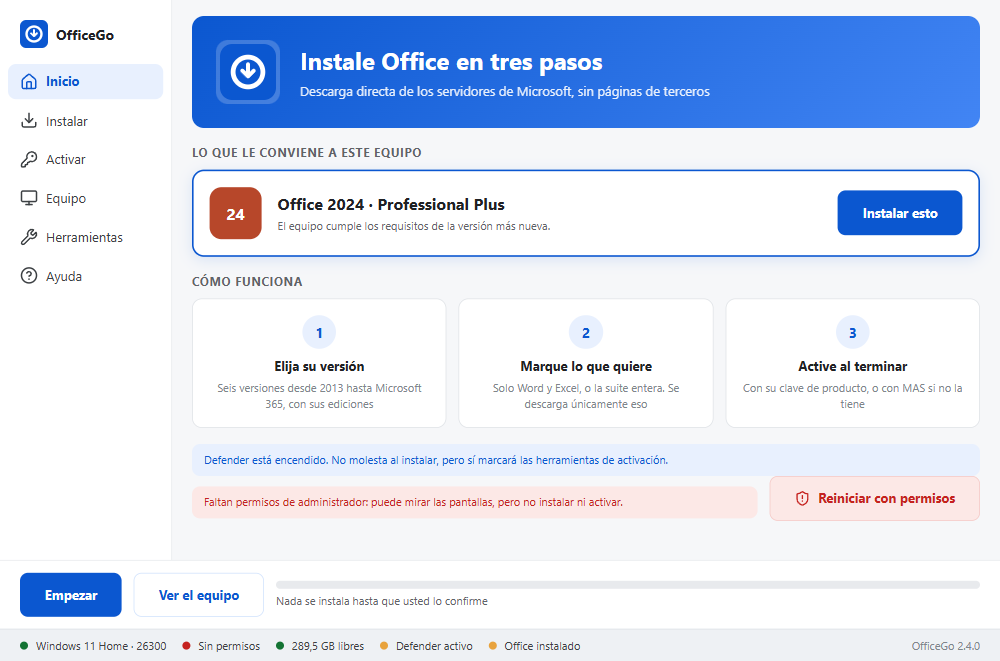
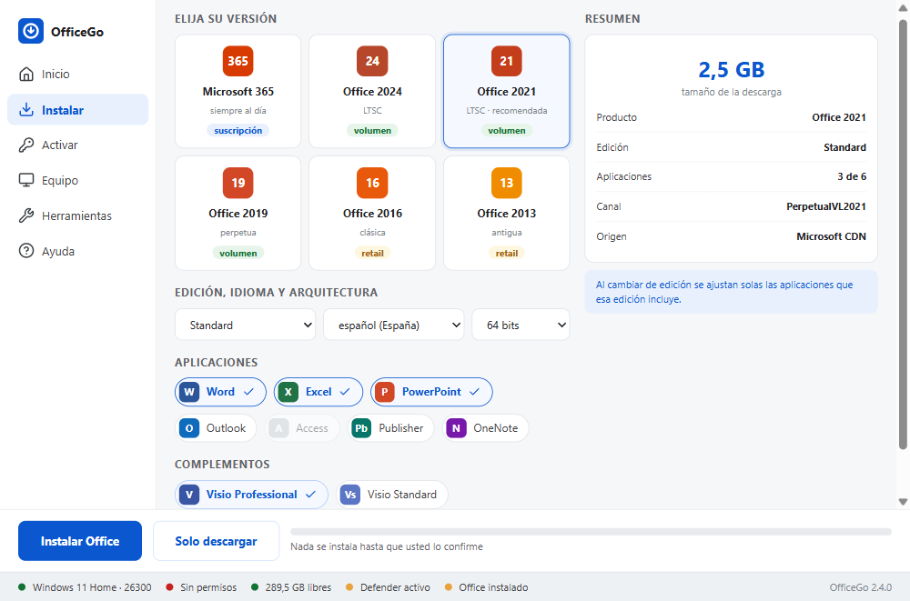
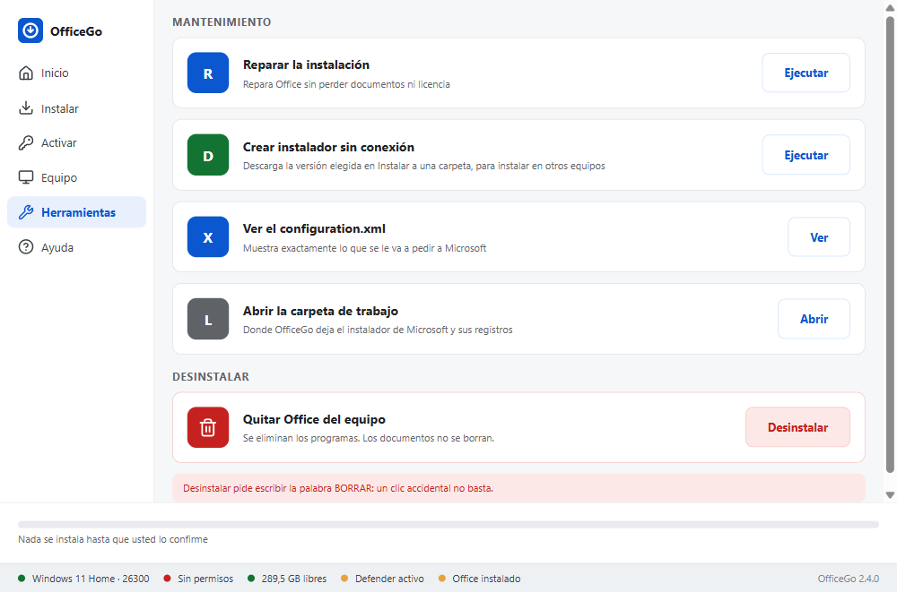
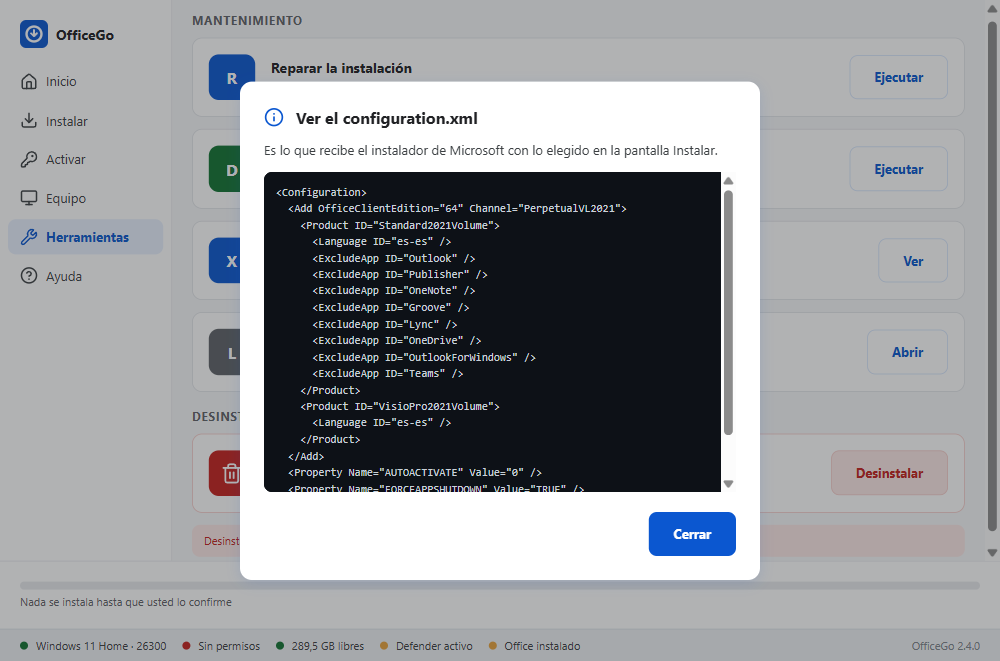

<div align="center">


# OfficeGo

### Microsoft Office en tu equipo, directo desde Microsoft.

Revisa tu equipo, te dice qué versión le conviene y la instala desde los servidores
oficiales de Microsoft. Sin páginas de terceros ni archivos de dudosa procedencia.


<br><br>

<a href="https://github.com/MariaDSalazar/officego/releases/latest/download/OfficeGo-setup.exe"></a>
&nbsp;
<a href="https://github.com/MariaDSalazar/officego/releases/latest/download/OfficeGo.exe"></a>

<sub>¿Equipo viejo o sin permisos para instalar? La versión PowerShell funciona en cualquier Windows 10 y 11, incluso [con un solo comando](#con-un-solo-comando).</sub>

<br>



</div>

---

## Por qué OfficeGo

<table>
<tr>
<td width="33%" valign="top">

### Solo Microsoft
Todo se descarga de `officecdn.microsoft.com` y `c2rsetup.officeapps.live.com`, con la
herramienta oficial de despliegue. No hay intermediarios ni archivos reempaquetados.

</td>
<td width="33%" valign="top">

### Te dice qué te conviene
Lee Windows, memoria, disco y gráfica, y propone la versión que de verdad le cabe a tu
equipo según los requisitos de Microsoft. Con 3 GB de RAM no te propone la última.

</td>
<td width="33%" valign="top">

### Tú decides qué entra
Solo Word y Excel, o la suite entera, con Visio o Project si los quieres. **Nada se
instala hasta que lo confirmas**, y se descarga únicamente lo que marcaste.

</td>
</tr>
</table>

## Elige tu versión

Las dos usan **el mismo motor**, así que instalan exactamente lo mismo. Cambia la forma.

| | 🖥️ **OfficeGo** (escritorio) | ⚡ **OfficeGo PowerShell** |
|---|---|---|
| **Para quién** | Windows 10 y 11 al día | Cualquier equipo, incluido el portátil viejo |
| **Cómo se usa** | Se instala, con su acceso en el menú Inicio | Un archivo que se abre y ya, o un comando |
| **Interfaz** | Svelte 5 sobre Rust (Tauri 2) | Windows Forms |
| **Peso** | Instalador de 1,5 MB | 90 KB |
| **Se actualiza sola** | Sí, desde la propia app | No hace falta: siempre baja la última |
| **Idiomas** | Español e inglés, según el sistema | Español |
| **Sin ventana, para un aula** | — | Sí, con opciones en la línea de órdenes |
| **Necesita** | WebView2 (el instalador lo pone si falta) | Nada |
| **Descarga** | [`OfficeGo-setup.exe`](https://github.com/MariaDSalazar/officego/releases/latest/download/OfficeGo-setup.exe) · [portable](https://github.com/MariaDSalazar/officego/releases/latest/download/OfficeGo-portable.exe) | [`OfficeGo.exe`](https://github.com/MariaDSalazar/officego/releases/latest/download/OfficeGo.exe) · [`.ps1`](https://github.com/MariaDSalazar/officego/releases/latest/download/OfficeGo.ps1) + [`.cmd`](https://github.com/MariaDSalazar/officego/releases/latest/download/OfficeGo.cmd) |

## Empieza en un minuto

### Con la app de escritorio

1. Baja [**OfficeGo-setup.exe**](https://github.com/MariaDSalazar/officego/releases/latest/download/OfficeGo-setup.exe) y ábrelo.
2. Si Windows avisa con «Windows protegió su PC»: **Más información** → **Ejecutar de todas formas**.
3. Abre OfficeGo desde el menú Inicio. Si te pide permisos de administrador, pulsa **Reiniciar con permisos**.
4. Pulsa **Instalar esto** en la versión que te recomienda, o elige otra en **Instalar**.

### Con un solo comando

Abre **PowerShell como administrador** (tecla <kbd>Windows</kbd> → escribe `PowerShell` →
*Ejecutar como administrador*) y pega:

```powershell
irm https://raw.githubusercontent.com/MariaDSalazar/officego/main/OfficeGo.ps1 | iex
```

Se abre la versión PowerShell. Si se te olvidó abrirlo como administrador, OfficeGo lo
nota, pide los permisos y se vuelve a abrir solo.

### Sin instalar nada

Baja [**OfficeGo.exe**](https://github.com/MariaDSalazar/officego/releases/latest/download/OfficeGo.exe)
y haz doble clic. Lleva el script dentro, no toca el registro y cabe en un USB.

> **¿Primera vez?** El **[tutorial](docs/TUTORIAL.md)** te lleva de la mano y dice en cada
> paso qué deberías ver en pantalla. ¿Con prisa? La **[guía rápida](docs/GUIA-RAPIDA.md)**
> lo cuenta en cinco minutos.

## Lo que hace

| | Función | Qué hace |
|---|---|---|
| 🎯 | **Recomienda por ti** | Propone la versión según tu Windows y tu memoria, y avisa si falta espacio, si el Windows es de 32 bits o si la gráfica es antigua. |
| 📦 | **Seis versiones** | Microsoft 365, Office 2024, 2021, 2019, 2016 y 2013, cada una con sus ediciones: Professional Plus, Standard, Home & Business… |
| ✅ | **Eliges las aplicaciones** | Al cambiar de edición se ajustan solas: con *Standard* se apaga Access porque esa edición no lo trae. |
| 📐 | **Visio y Project** | Como complementos, en el mismo pedido que Office. |
| 🔑 | **Activación** | Con tu clave de 25 caracteres, con guiones o sin ellos, o con MAS sin abrir su menú. Todo dentro de la ventana. |
| 🖥️ | **Conoce tu equipo** | Procesador con su uso, memoria, cada disco con su espacio libre y la gráfica con su marca. Y un informe para copiar y pegar. |
| 🧰 | **Herramientas** | Reparar Office, crear un **instalador sin conexión** para llevar a otro equipo y desinstalar (pidiendo escribir la palabra, no basta un clic). |
| 🔄 | **Se actualiza sola** | La app avisa de cada versión nueva, comprueba que la descarga llegó entera y se instala encima sin perder nada. |
| ⚡ | **Desatendido** | `-Instalar 2021 -Apps Word,Excel -Silencioso -Activar` deja un aula entera igual sin que nadie toque nada. |
| 🔒 | **Sin telemetría** | No manda nada a ninguna parte. El código está aquí para leerlo. |

## Novedades de la 2.4

- **La app de escritorio, rehecha en Svelte 5 y Rust.** Abre en unos 3 segundos (antes
  más de 10), habla español o inglés según el sistema y se actualiza sola.
- **Todo lo de la versión PowerShell, ahora también en la app:** reiniciar con permisos,
  clave de producto, reparar y el instalador sin conexión.
- **Office 2016 y 2013 de 32 bits por fin se instalan.** Microsoft llama `x86` a los 32
  bits y se le pedía `x32`.
- **Office de Click-to-Run se detecta.** Con 2019, 2021, 2024 o 365 instalados se decía que
  no había Office y no se podía comprobar la licencia.
- **Visio y Project ya no desaparecen** al cambiar de versión o de edición.

La lista completa está en el [CHANGELOG](CHANGELOG.md) y en las notas de cada
[versión publicada](https://github.com/MariaDSalazar/officego/releases).

## Así se ve

<table>
<tr>
<td width="50%"><br><sub><b>Instalar.</b> Office 2021 Standard con Visio: Access se apaga solo porque esa edición no lo trae.</sub></td>
<td width="50%"><br><sub><b>Equipo.</b> La recomendación arriba y cada pieza del equipo con su uso.</sub></td>
</tr>
<tr>
<td width="50%"><br><sub><b>Herramientas.</b> Reparar, instalador sin conexión y desinstalar.</sub></td>
<td width="50%"><br><sub><b>Transparente.</b> El <code>configuration.xml</code> exacto que recibirá Microsoft.</sub></td>
</tr>
</table>

<details>
<summary><b>La versión PowerShell</b></summary>
<br>

| | |
|---|---|
|  |  |
|  |  |

Con 3 GB de RAM y Windows 10 build 18363 la recomendación **cambia sola a Office 2016**,
el marco pasa a ámbar y aparecen los avisos que correspondan.

</details>

## Qué versión de Office te toca

Las reglas salen de los requisitos que publica Microsoft:

| Versión | Necesita |
|---|---|
| Office LTSC **2024** | Windows 11, o Windows 10 versión 22H2 |
| Office LTSC **2021** | Windows 10 versión 1809 o superior |
| Office **2019** | Windows 10 |
| Office **2016** / **2013** | Windows 7 SP1 en adelante |

Con menos de 4 GB de RAM se recomienda siempre la versión más ligera, mande lo que mande
el Windows.

| Requisito | |
|---|---|
| Sistema | Windows 10 (build 10240) o Windows 11 |
| Permisos | Administrador |
| Disco | 5 GB libres en la unidad del sistema |
| Red | Conexión a internet (o un instalador sin conexión hecho antes) |

## Preguntas frecuentes

<details>
<summary><b>Windows dice «Windows protegió su PC»</b></summary>
<br>

Sale con cualquier `.exe` descargado que no esté firmado, y firmarlo cuesta cientos de
euros al año. Pulsa **Más información** → **Ejecutar de todas formas**. Si prefieres no
bajar ningún `.exe`, usa [el comando](#con-un-solo-comando) o compila el tuyo con
`compilar-exe.bat`: usa el compilador de C# que Windows ya trae, y lo que compilas en tu
equipo SmartScreen no lo marca igual.

</details>

<details>
<summary><b>El antivirus bloquea la activación</b></summary>
<br>

El instalador no da problemas: descarga de dominios de Microsoft y no hace nada ofuscado.
**MAS sí lo detecta Windows Defender**, siempre y por diseño, y lo advierte la propia web
de massgrave.dev. OfficeGo lo avisa antes de lanzarlo: pausa la protección un momento y
**vuelve a encenderla al terminar**.

</details>

<details>
<summary><b>Quiero instalar Office en un equipo sin internet</b></summary>
<br>

En un equipo con conexión, **Herramientas → Crear instalador sin conexión** baja la
versión elegida a una carpeta. Copia la carpeta entera al otro equipo y abre
`instalar.cmd`: Office se instala desde esos archivos.

</details>

<details>
<summary><b>Quiero instalarlo igual en todo un aula</b></summary>
<br>

La versión PowerShell acepta opciones y puede ir sin ventanas:

```powershell
& ([scriptblock]::Create((irm https://raw.githubusercontent.com/MariaDSalazar/officego/main/OfficeGo.ps1))) -Instalar 2021 -Apps Word,Excel,PowerPoint -Silencioso -Activar
```

| Opción | Qué hace |
|---|---|
| `-Instalar` | `365` `2024` `2021` `2019` `2016` `2013` |
| `-Edicion` | `ProPlus` (por defecto), `Standard`, `Professional`, `HomeStudent`… |
| `-Apps` | `Word,Excel,PowerPoint`. Lo que no se nombre, no se instala |
| `-Complementos` | `VisioPro`, `VisioStd`, `ProjectPro`, `ProjectStd` |
| `-Idioma` | `es-es` (por defecto), `es-mx`, `en-us`… |
| `-Bits` | `64` o `32`. Por defecto, lo que sea el Windows |
| `-Activar` | Activa al terminar. Suelto, activa sin instalar nada |
| `-Desinstalar` | Quita Office del equipo |
| `-Silencioso` | Sin ventanas de Microsoft ni preguntas |
| `-Ayuda` | Enseña todo esto en pantalla |

El `[scriptblock]::Create` no es adorno: con `irm | iex` no se pueden pasar parámetros.
`OfficeGo.exe` admite las mismas opciones: `.\OfficeGo.exe -Instalar 2021 -Apps Word,Excel`.

</details>

<details>
<summary><b>La barra de progreso se queda quieta</b></summary>
<br>

Mientras Microsoft descomprime, la barra puede pararse varios minutos. Si el tiempo de
abajo sigue avanzando, está trabajando. Instalar tarda entre 10 y 30 minutos.

</details>

## Cómo está hecho

```
  App de escritorio:  Svelte 5 ─► Rust (Tauri 2, tipos con ts-rs) ─► motor-api.ps1 ─┐
  Versión PowerShell: Windows Forms ────────────────────────────────────────────────┤
                                                                                    ▼
                                 src/*.ps1 · el mismo motor para las dos versiones

  Equipo ─► WMI (Windows, CPU, RAM, discos, GPU) ─► recomendación de versión
         ─► catálogo (Product ID + vía + canal) ─► configuration.xml
         ─► setup.exe /configure  ó  c2rsetup ─► Office instalado
         └─► clave de producto, o MAS /Ohook en segundo plano ─► activado
```

Microsoft ofrece **dos vías, y no son intercambiables**:

| Vía | Sirve para | ¿Elegir aplicaciones? |
|---|---|---|
| **ODT** · `setup.exe /configure` | Microsoft 365, Office 2024, 2021 y 2019 | Sí, con `<ExcludeApp>` |
| **C2R** · `c2rsetup.officeapps.live.com` | Office 2016 y 2013 | No: baja la suite entera |

Por eso, con 2016 o 2013 la lista de aplicaciones se desactiva sola. No es una
limitación de OfficeGo, es de Microsoft.

<details>
<summary><b>El repositorio por dentro</b></summary>
<br>

```
officego/
├── src/                    El motor y la versión PowerShell
│   ├── 1-catalogo.ps1          Versiones, ediciones y qué trae cada una
│   ├── 2-motor.ps1             Descargas, configuration.xml, WMI, clave y MAS
│   ├── 2b-recomendacion.ps1    Qué versión le conviene a este equipo
│   └── 3…7-*.ps1               Ventana, pantallas, acciones y arranque
├── tauri/                  La app de escritorio · ver tauri/LEEME.md
│   ├── src/                    Svelte 5: pantallas, componentes y servicios
│   ├── locales/                Los textos, en español e inglés
│   ├── design/tokens.json      Colores, espacios y letra en un solo sitio
│   └── src-tauri/              Rust: el puente con el motor y las actualizaciones
├── OfficeGo.ps1            Se genera con build.sh: no se edita a mano
├── OfficeGo.cmd            Lanzador de doble clic
├── compilar-exe.bat        Genera OfficeGo.exe con el csc.exe que trae Windows
├── test.ps1 y prueba-*.ps1 Las pruebas de la versión PowerShell
├── docs/                   Tutorial, guía rápida y pruebas en máquina virtual
└── CHANGELOG.md            Lo nuevo de la última versión
```

</details>

<details>
<summary><b>Para desarrollar</b></summary>
<br>

```bash
./build.sh                             # junta src/*.ps1 y valida la sintaxis
pwsh test.ps1                          # 65 pruebas del motor
pwsh prueba-arranque.ps1               # que arranque por irm|iex y como archivo
pwsh prueba-interfaz.ps1               # que las pantallas no se solapen
pwsh prueba-interfaz.ps1 -Factor 1.15  # lo mismo con la letra más ancha
```

Las de PowerShell no necesitan Windows. La app de escritorio tiene las suyas (lint,
tipos, clippy y 38 pruebas de Rust, una de ellas contra el motor de verdad) y su guía
en [`tauri/LEEME.md`](tauri/LEEME.md).

Una versión se publica subiendo una etiqueta `vX.Y.Z`: el CI comprueba todo en un
Windows y sube los cinco archivos con el `CHANGELOG.md` como notas. Nada se compila en
cada push.

</details>

<details>
<summary><b>Cómo se comprueba cada versión</b></summary>
<br>

Antes de publicar, en un Windows de verdad: las 65 pruebas del motor, el arranque por
las dos vías y el análisis de solapes de las seis pantallas, todo también en el
**PowerShell 5.1 que trae Windows**; y en la app, lint, tipos, clippy y las pruebas de
Rust. La 2.4 se abrió y se recorrió entera en un Windows 11, y las descargas de cada vía
se comprobaron contra los servidores de Microsoft.

Instalar, activar o desinstalar Office de verdad cambia el equipo, así que eso se prueba
con la [checklist en máquina virtual](docs/PRUEBAS-VM.md). Si ves algo raro,
[abre un issue](https://github.com/MariaDSalazar/officego/issues/new) con una captura.

</details>

## Quién lo hace

<table align="center">
<tr>
<td align="center" width="220">
<a href="https://github.com/DiegoFernandoLojanTenesaca"><br><b>Diego Fernando Loján Tenesaca</b></a><br>
<sub>Desarrollo e interfaz</sub>
</td>
<td align="center" width="220">
<a href="https://github.com/MariaDSalazar"><br><b>María del Carmen Salazar Torres</b></a><br>
<sub>Script base y documentación</sub>
</td>
</tr>
</table>

**Gracias a** la [Office Deployment Tool](https://learn.microsoft.com/microsoft-365-apps/deploy/overview-office-deployment-tool)
de Microsoft, a [MAS · Microsoft Activation Scripts](https://github.com/massgravel/Microsoft-Activation-Scripts),
proyecto independiente, y a la comunidad de [massgrave.dev](https://massgrave.dev), de
donde salió la idea del catálogo de versiones.

> [!NOTE]
> Activar productos sin pagar la licencia va contra los términos de Microsoft. Este
> proyecto se publica con fines educativos y de administración de equipos propios.

Licencia [MIT](LICENSE).

<div align="center">
<br>
<sub><b>OfficeGo</b> · Office donde lo pone Microsoft, sin vueltas.</sub>
</div>
